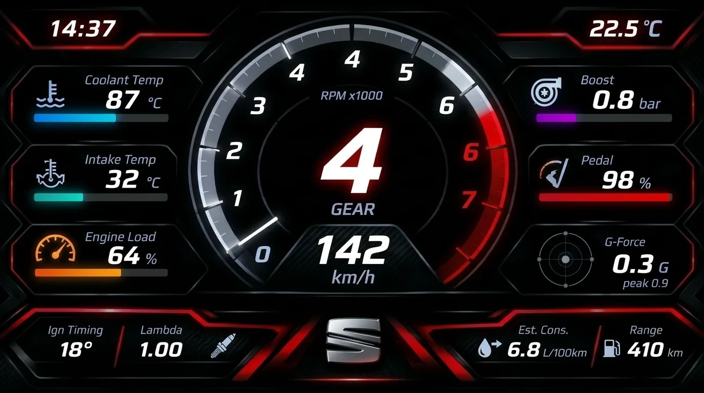

# Diseño de referencia del dashboard

`referencia.webp` es la referencia de **estilo** del dashboard de Android Auto (Fase 2). Se generó con IA, así que la app la sigue en aspecto (fibra de carbono, paneles biselados con filo rojo brillante, fuente cursiva, iconos de color con halo, barras con brillo, logo abajo en el centro) pero **no** copia estos detalles:

| En la imagen | En la app |
|---|---|
| Escala del cuentarrevoluciones con números repetidos (0-1-2-3-4-4-5-6-6-7) | Escala 0 a 7 (RPM x1000), zona roja desde 5.500 rpm. El relleno del arco sigue a las RPM reales y todo el arco parpadea al llegar al corte |
| Textos pequeños ("RPM x1000", "peak 0.9", unidades) | Tamaño mínimo legible en la pantalla real del coche; todos los textos se miden para que quepan |
| Sin indicador de estado | Con datos en vivo no se muestra nada. Si falta algo (BUSCANDO ADAPTADOR, SIN CONEXIÓN, SIN DATOS DE LA ECU, SIMULACIÓN, BLUETOOTH APAGADO, FALTAN PERMISOS) aparece un aviso arriba en el centro |
| Tamaño fijo 16:9 | Se dibuja dentro del `stableArea` que da Android Auto, sea cual sea su proporción |

Datos de cada zona:

- **Centro:** marcha (grande), velocidad en km/h (panel bajo el arco), RPM en el arco.
- **Izquierda:** Coolant Temp (PID 05), Intake Temp (0F), Engine Load (04).
- **Derecha:** Boost (MAP 0B − baro 33), Pedal (49), G-Force (sensores del móvil) con pico de la sesión.
- **Abajo izquierda:** Ign Timing (0E), Lambda objetivo (44).
- **Abajo derecha:** consumo y autonomía **estimados** (sin MAF ni caudal de combustible en esta ECU).
- **Arriba:** hora del móvil y temperatura exterior (PID 46).

Sin dato, cada valor se muestra como `--` en gris.
